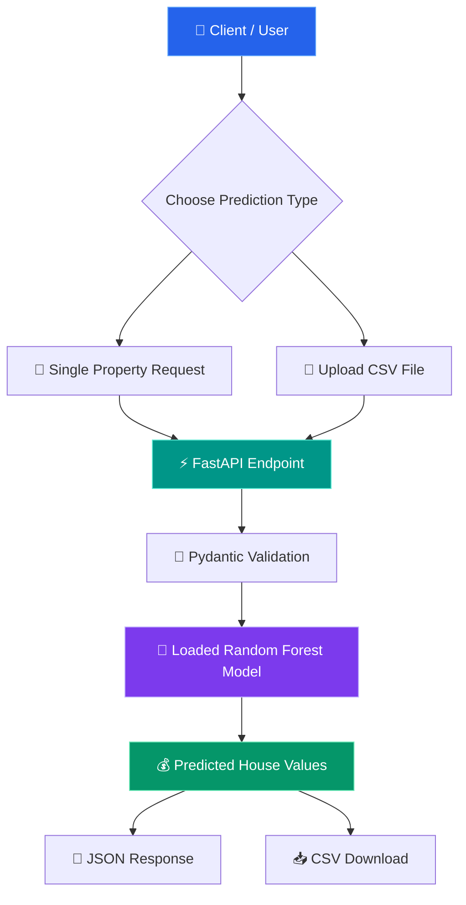

<!-- ===================== HEADER (animated gradient wave) ===================== -->
<div align="center">


<!-- Typing animation -->
<a href="https://github.com/Kumaresh2005/House-price-prediction-using-FastAPI">
  
</a>

<br/>

**Turning housing data into intelligent predictions 🚀**

<br/>

[](https://www.python.org/)
[](https://fastapi.tiangolo.com/)
[](https://scikit-learn.org/)
[](https://pandas.pydata.org/)
[](LICENSE)


<br/>

[**🚀 Repository**](https://github.com/Kumaresh2005/House-price-prediction-using-FastAPI) &nbsp;•&nbsp; [**📖 API Docs**](http://127.0.0.1:8000/docs) &nbsp;•&nbsp; [**💻 Get Started**](#-getting-started) &nbsp;•&nbsp; [**🧠 ML Workflow**](#-machine-learning-workflow)

</div>


## 📌 Table of Contents

- [✨ Features](#-features)
- [🛠️ Tech Stack](#️-tech-stack)
- [🏗️ Architecture](#️-system-architecture)
- [📁 Project Structure](#-project-structure)
- [🚀 Getting Started](#-getting-started)
- [🔌 API Usage](#-api-usage)
- [🧠 Machine Learning Workflow](#-machine-learning-workflow)
- [🔮 Roadmap](#-roadmap)
- [👨‍💻 Author](#-author)


## ✨ Features

<table>
<tr>
<td width="50%" valign="top">

### 🎯 Single Prediction
Send one property's details and get a predicted house value back as JSON. Inputs are validated automatically.

</td>
<td width="50%" valign="top">

### 📂 Batch CSV Prediction
Upload a CSV with many properties and download a CSV with predictions added.

</td>
</tr>
<tr>
<td width="50%" valign="top">

### ⚡ Fast & Modern API
Built with FastAPI, so you get quick responses and automatic request validation.

</td>
<td width="50%" valign="top">

### 🧠 Pre-trained Model
A saved Random Forest model is loaded once at startup, so there is no retraining on every request.

</td>
</tr>
<tr>
<td colspan="2" valign="top">

### 📖 Built-in Interactive Docs
Test every endpoint in your browser using Swagger UI at `/docs` or ReDoc at `/redoc`. No Postman needed.

</td>
</tr>
</table>

## 🛠️ Tech Stack

<div align="center">

| | Technology | Purpose |
|:-:|:---|:---|
| 🐍 | **Python** | Core language |
| ⚡ | **FastAPI** | REST API framework |
| 🌲 | **Random Forest Regressor** | House value prediction |
| 🤖 | **Scikit-learn** | Model training & dataset |
| 🐼 | **Pandas** | Data handling & CSV processing |
| 🔢 | **NumPy** | Numerical operations |
| 📦 | **Joblib** | Save / load model files |
| 🧪 | **Pydantic** | Input validation |
| 🚀 | **Uvicorn** | ASGI server |

</div>

## 🏗️ System Architecture



## 📁 Project Structure

```text
House-price-prediction-using-FastAPI/
│
├── main.py                                   # FastAPI app & prediction endpoints
├── train.py                                  # Trains the model on California housing data
├── explore.py                                # Dataset exploration
├── house_model.joblib                        # Saved Random Forest model
├── house_features.joblib                     # Expected feature names & order
├── california_house_prediction_5_samples.csv # Sample file for batch testing
├── requirements.txt                          # Dependencies
└── README.md                                 # You are here
```


## 🚀 Getting Started

### 1️⃣ Clone the repository

```bash
git clone https://github.com/Kumaresh2005/House-price-prediction-using-FastAPI.git
cd House-price-prediction-using-FastAPI
```

### 2️⃣ Create a virtual environment

```bash
python -m venv venv
```

### 3️⃣ Activate it

<details>
<summary><b>🪟 Windows (PowerShell)</b></summary>

```powershell
.\venv\Scripts\Activate.ps1
```
</details>

<details>
<summary><b>🪟 Windows (Command Prompt)</b></summary>

```cmd
venv\Scripts\activate
```
</details>

<details>
<summary><b>🐧 Linux / 🍎 macOS</b></summary>

```bash
source venv/bin/activate
```
</details>

### 4️⃣ Install dependencies

```bash
python -m pip install --upgrade pip
pip install -r requirements.txt
```

### 5️⃣ (Optional) Train the model

Only needed if `house_model.joblib` and `house_features.joblib` are missing.

```bash
python train.py
```

### 6️⃣ Start the server

```bash
uvicorn main:app --reload
```

### 7️⃣ Open in your browser

| Resource | URL |
|:---|:---|
| ⚡ Swagger UI | http://127.0.0.1:8000/docs |
| 📘 ReDoc | http://127.0.0.1:8000/redoc |
| 🏠 API Root | http://127.0.0.1:8000/ |

> 💡 **Tip:** Swagger UI lets you click **"Try it out"** on any endpoint and test it right away.

## 🔌 API Usage

> The exact endpoint paths and field names are defined in `main.py`. Always check `/docs` for the current schema.

### 🎯 Single House Prediction

```text
Property Features  →  Validation  →  Random Forest  →  Predicted Value
```

Example input (the California housing dataset uses these 8 features):

```json
{
  "MedInc": 8.3252,
  "HouseAge": 41.0,
  "AveRooms": 6.98,
  "AveBedrms": 1.02,
  "Population": 322.0,
  "AveOccup": 2.55,
  "Latitude": 37.88,
  "Longitude": -122.23
}
```

<details>
<summary><b>📖 What do these features mean?</b></summary>

| Feature | Meaning |
|:---|:---|
| `MedInc` | Median income in the area (in tens of thousands of dollars) |
| `HouseAge` | Median age of houses in the area |
| `AveRooms` | Average number of rooms per household |
| `AveBedrms` | Average number of bedrooms per household |
| `Population` | Number of people living in the area |
| `AveOccup` | Average number of people per household |
| `Latitude` | North–south location |
| `Longitude` | East–west location |

In the original dataset, the target value is given in units of **$100,000**.

</details>

### 📊 Batch Prediction with CSV

1. Prepare a CSV with the required feature columns (or use the included sample).
2. Open **http://127.0.0.1:8000/docs**.
3. Choose the batch prediction endpoint and click **Try it out**.
4. Upload your CSV and click **Execute**.
5. Download the result.

> 📥 **Try it now:** use `california_house_prediction_5_samples.csv` from this repo.

## 🧠 Machine Learning Workflow

<div align="center">

`📊 California Housing Dataset` ➜ `🧹 Feature Preparation` ➜ `🌲 Random Forest Regressor` ➜ `💾 Saved with Joblib` ➜ `⚡ FastAPI Predictions`

</div>

| | |
|:---|:---|
| **Model** | Random Forest Regressor |
| **Problem type** | Regression |
| **Dataset** | California housing (from Scikit-learn) |
| **Target** | Median house value |
| **Metrics (MAE / RMSE / R²)** | _Add your results here after testing on a held-out set_ |

## 🔮 Roadmap

- [ ] ☁️ Deploy the API to a cloud platform
- [ ] 🧪 Add unit and integration tests
- [ ] 📈 Add model metrics (MAE, RMSE, R²)
- [ ] 📝 Add structured logging and better error handling
- [ ] 🐳 Add Docker support
- [ ] 🖥️ Build a frontend for interactive predictions
- [ ] 🔁 Add CI with GitHub Actions


## 👨‍💻 Author

<div align="center">

### Kumaresh Biswas

**Data Science • Machine Learning • Python Backend Development**


<br/><br/>

[](https://github.com/Kumaresh2005)
[](https://www.linkedin.com/in/kumaresh-biswas)

<br/>

⭐ **If this project helped you, please give it a star!** ⭐

</div>

<!-- ===================== FOOTER (animated gradient wave) ===================== -->

